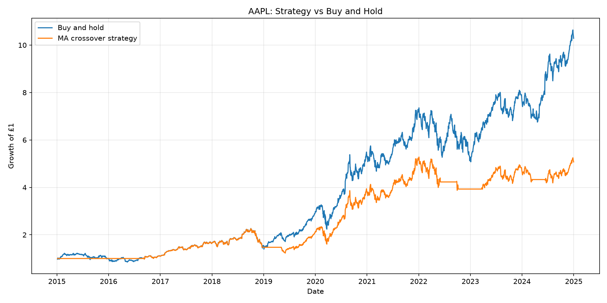
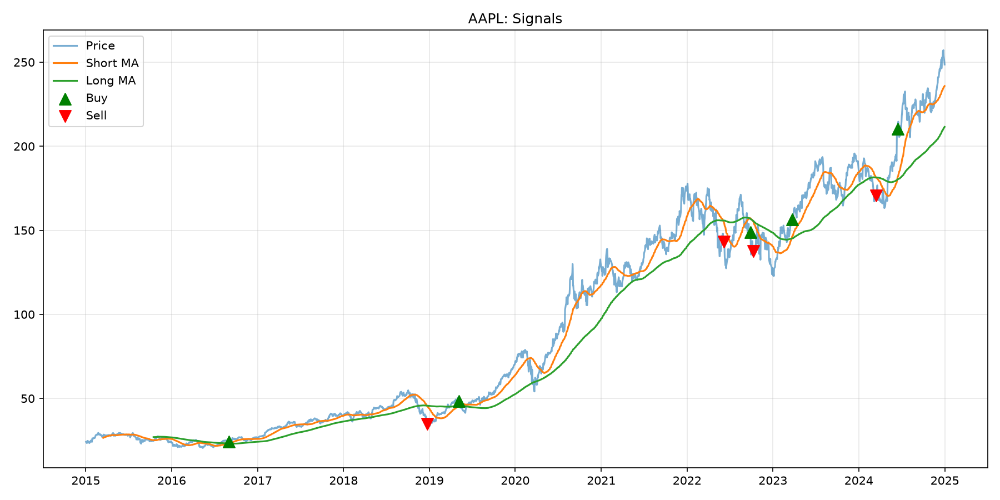

# MA Backtester

A Python tool that backtests a moving-average crossover strategy against buy-and-hold on historical stock data.

- Downloads daily prices with yfinance and caches them as CSV
- Holds the stock when the 50-day average is above the 200-day average, otherwise stays in cash
- Shifts signals by one day to avoid look-ahead bias
- Reports total return, annualised return, volatility, Sharpe ratio and max drawdown

## Usage
```bash
pip install -r requirements.txt
python main.py --ticker AAPL --short 50 --long 200
```

## Results (AAPL, 2015-2025)
| | Total return | Sharpe | Max drawdown |
|---|---|---|---|
| Buy and hold | 928.5% | 0.96 | -38.5% |
| Strategy | 407.3% | 0.81 | -45.6% |

The crossover strategy returned 407.3%, so it lost to buy-and-hold, which returned 928.5%, on AAPL (2015-2025).




## Limitations
- No transaction costs or slippage
- Parameters may be overfitted to the past
- Results depend on the stock and time period
- Past performance does not predict future results

## Tests
```bash
pytest
```
